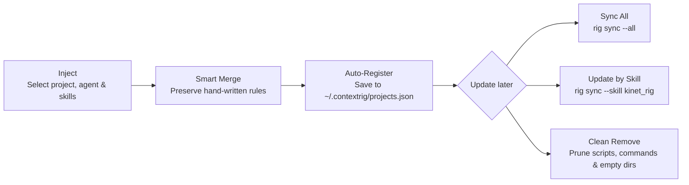

<div align="center">


# ContextRig

**Project-scoped context, tool & skill provisioner for AI coding agents.**<br>
Rig any repository with tailored AI rules, executable scripts, dependencies, `.gitignore` rules, and cloud-synced updates across Claude Code, Cursor, OpenCode, GitHub Copilot, and ChatGPT — without context bloat or overwriting your custom rules.

[](package.json)
[](README.md)
[](#supported-ai-agent-profiles)
[](#cloud-sync--project-registry)
[](#quick-start)

[Why](#why) · [Supported agents](#supported-ai-agent-profiles) · [Skills library](#curated-skills-library) · [Workflow](#recommended-workflow) · [Quick start](#quick-start) · [Web console](#web-console) · [Cloud sync](#cloud-sync--project-registry) · [Layout](#repository-layout) · [FAQ](#faq)

</div>

---

## Why

Global AI skill folders dump every tool into every repository, bloating context windows and confusing models with irrelevant instructions. Manual per-repo setup, on the other hand, leaves scripts stale and rules inconsistent across projects.

**ContextRig** keeps skills **strictly project-scoped** while making cross-project management effortless via a global project registry (`~/.contextrig/projects.json`), Smart Merge, and conditional GitHub sync.

| Manual or Global Setup | ContextRig CLI |
|---|---|
| Global skill dumps bloat every project's prompt | **Project-Scoped Injection** — equip only what each repo needs |
| Copy-pasting `CLAUDE.md` / `.cursorrules` by hand | **5 Native Agent Templates** + Claude `.claude/commands/*.md` |
| Updates wipe hand-written project rules | **Smart Merge** (`mergeMode: 'merge'`) updates skill blocks in-place |
| Retyping folder paths to update every repo | **Global Registry + Sync All / By Skill** (`rig sync --all`) |
| Hitting GitHub API rate limits on every check | **ETag `304` + SHA-256 Hash Guard** + 1-hour TTL cache |

---

## Supported AI Agent Profiles

<details open>
<summary><b>5 agent profiles</b> — generated from modular Handlebars templates</summary>

| Profile | Output File | Template | Extras |
|---|---|---|---|
| **Claude Code** | `CLAUDE.md` | `templates/claude.md.hbs` | Generates `.claude/commands/<name>.md` slash commands |
| **Cursor** | `.cursorrules` | `templates/cursorrules.hbs` | Project-scoped Composer & AI rules |
| **OpenCode** | `AGENTS.md` | `templates/opencode.md.hbs` | Multi-agent specification |
| **GitHub Copilot** | `.github/copilot-instructions.md` | `templates/copilot.md.hbs` | Repository Copilot instructions |
| **ChatGPT** | `CHATGPT.md` | `templates/chatgpt.md.hbs` | Context & guidelines for ChatGPT Projects |

</details>

---

## Curated Skills Library

<details open>
<summary><b>10 catalog skills</b> — scripts, instructions, dependencies & auto-gitignore</summary>

| Skill ID | Name | Slash Command | Injected Assets | Purpose |
|---|---|---|---|---|
| `artcraft` | **ArtCraft Suite (19 Apps)** | `/artcraft` | `rigtools/artcraft/` | Evidence-verified playbooks & automation for EffectCraft (VFX), FilmCraft (NLE), AniCraft, and 16 more creative apps |
| `kinet_rig` | **KinetRig (144–240 FPS)** | `/kinet-rig` | `rigtools/kinet_rig/` | Zero-dependency Ultra-HFR HTML5/GSAP/Three.js motion & video engine with live Web Audio capture |
| `cut_rig` | **CutRig MCP** | `/cut` | `rigtools/cut_rig/` | NLE timeline automation & video editing adapters (CapCut, DaVinci, Premiere Pro, FFmpeg) |
| `ui_ux_pro_max` | **UI/UX Pro Max** | `/ui-ux` | `rigtools/ui_ux_pro_max/` | UI/UX design intelligence, 141 guidelines, 194 palettes, token export & preview generation |
| `archify` | **Archify** | `/archify` | *(Agent skill & rules)* | Interactive HTML architecture diagrams, ERD, sequence, and workflow visualizers |
| `graphify` | **Graphify** | `/graphify` | `rigtools/graphify.py` | Codebase dependency graph (`graphify-out/graph.html`), God Nodes & architectural report |
| `web_scraper` | **Web Scraper** | `/scrape` | `rigtools/scraper.py` | Clean webpage text extraction from URLs or docs straight in terminal |
| `playwright` | **Playwright** | `/playwright` | `rigtools/playwright_runner.js` | Headless Chromium runner for E2E checks, screenshots, and console error inspection |
| `db_inspector` | **DB Schema Inspector** | — | `rigtools/db_inspector.js` | Inspects SQLite databases & `.env` profiles into `docs/db_schema.md` |
| `git_workflow` | **Git Workflow** | `/commit`, `/commit-v` | *(System rules & command)* | Enforces Conventional Commits, diff metrics, secret guards, and version contract detection |

</details>

> Skill assets are **not** bundled with the npm package. The catalog ships metadata only; the Web Console installs a skill into `~/.contextrig/` when you click **Install**, or automatically on first injection of a selected skill from the CLI.

---

## Recommended Workflow



1. **Inject once per project (`[1] Inject Skills`):** ContextRig detects existing agent files & installed skills, preserves custom rules via Smart Merge, installs `npm`/`pip` dependencies, updates `.gitignore`, and registers the project in `~/.contextrig/projects.json`.
2. **Sync without typing paths (`[2] Sync & Update`):** Run `Sync All Registered Projects`, `Update by Skill` (push to projects or refresh ContextRig's master `scripts/`), or target the current working folder.
3. **Clean uninstall (`[3] Remove Skills`):** Deletes only the removed skill's files, slash commands, optional generated artifacts, and empty subdirectories without touching sibling skills.

---

## Quick Start

#> **Beta (v0.4.2)** — ContextRig is pre-1.0. Expect breaking changes between minor versions while the skill manifest and CLI surface stabilise.

## Installation

The npm package ships **only the engine** (`src/`, `templates/`, `skills_catalog.json`) — roughly 130 kB. No skill assets are bundled; you install the skills you want on demand.

```bash
npm install -g contextrig
rig
```

Running `rig` opens the interface selector: **Web Console** (`http://localhost:7474`) or **Terminal UI**.

First run flow:

1. Open the **Skills** tab and click **Install** on any card. A confirmation dialog shows the file count and estimated storage before anything is downloaded.
2. Installed skills land in `~/.contextrig/skills_library/` (manifests) and `~/.contextrig/scripts/` (tool files). Remove them with `···` → **Remove from device**; reinstall any time.
3. Go to **Projects → Inject into project**, type a directory, pick the agent profile and skills, then Inject.

### Install from source (development)

```bash
git clone https://github.com/Reff33/ContextRig.git
cd ContextRig
npm install
npm link
```

### Interactive & Direct CLI Commands

```bash
# Launch interface selector (Web / Terminal UI)
rig

# Open the Web Console directly
rig --web

# Open the Terminal UI directly
rig --tui

# Open Sync Hub (Sync All / Update by Skill / Current Folder / Registered Projects)
rig sync

# Check & update all registered projects in one command
rig sync --all
rig sync --all --yes

# Skill-first update across all projects using a specific skill
rig sync --skill kinet_rig

# Sync a specific folder directly
rig sync ./my-project

# Clean uninstall — strips managed rules from every project, deletes ~/.contextrig
rig --uninstall
rig --uninstall --yes
```

---

## Uninstall

ContextRig can remove itself without leaving rules behind in your projects.

```bash
rig --uninstall          # preview what will be removed, then confirm
rig --uninstall --yes    # non-interactive
npm uninstall -g contextrig
```

What it removes, per registered project:

| Removed | Kept |
|---|---|
| The managed `## Available AI Skills & Tools` block | Every hand-written rule you added |
| Injected `rigtools/` / `tools/` files | Your code and git history |
| Generated slash commands (`.claude/commands/*.md`) | Files you created yourself |
| Skill artifact dirs (`graphify-out/`, `.archify/`, …) | — |
| `.contextrig_cache.json` and orphaned `.mcp.json` entries | — |

It then empties `~/.contextrig/projects.json` and deletes `~/.contextrig/` (installed manifests, scripts, `skill-settings.json`, update cache). The same flow is available in the Web Console under **Settings → Uninstall ContextRig**, which shows a review dialog before anything is deleted.

---

## Web Console

`rig --web` serves a local, single-page console at `http://localhost:7474`. It reads and writes the exact same local state as the CLI — nothing leaves your machine.

| Tab | What you can do |
|---|---|
| **Overview** | KPI cards, health/agent footprint, top adopted skills, recent activity, provisioning matrix |
| **Projects** | Browse, filter and paginate registered projects; inject into any directory; remove skills (real file deletion); import skills from GitHub / skills.sh |
| **Sync & Ops** | Engine health checks, **Sync Now** per project, **Sync All Projects**, copyable CLI commands |
| **Skills** | Catalog with per-skill status (`Not on device` / `On device` / `In projects · uncached` / `Installed`), Install / Update / Remove from device, custom image per skill |
| **Settings** | Accent palettes (5 core + more), per-skill parameters with `DEFAULT` vs `CUSTOM` badges, extra AI instructions, live JSON/Markdown preview |

Also included: `Ctrl/⌘ K` command palette, `Ctrl/⌘ S` to save settings, `[` to collapse the sidebar, and Light/Dark modes that work with every palette.

---

## Cloud Sync & Project Registry

1. **ETag Conditional Requests (`If-None-Match`):** Remote files are checked with ETags so unchanged files return `304 Not Modified` with zero GitHub rate-limit cost.
2. **Local Integrity Guard:** ContextRig tracks SHA-256 hashes in `.contextrig_cache.json`. If a target file was deleted or edited locally, `304` caching is bypassed and the file is cleanly restored.
3. **Remote Preservation + Smart Merge:** Sync writes staged remote files first, then updates `CLAUDE.md` / `.cursorrules` in `merge` mode without copying stale local `scripts/` over fetched updates.
4. **Global Project Registry (`~/.contextrig/projects.json`):** Automatically remembers injected projects, configured agents, and skills, pruning deleted directories automatically during `Sync All`.
5. **GitHub Token Support:** Reads `GITHUB_TOKEN` from your environment or project `.env` to raise GitHub API limits from 60/hr to 5,000/hr.

---

## Repository Layout

```text
ContextRig/
├── assets/
│   └── image/
│       └── ContextRig Icon.png      Project icon
├── src/
│   ├── index.js                     CLI entry point, interactive menu & subcommands
│   ├── config.js                    Paths & supported AI agent profiles
│   ├── core/
│   │   ├── projectSetup.js          Path sanitization & target directory validation
│   │   ├── projectRegistry.js       Global ~/.contextrig/projects.json registry
│   │   ├── agentSelector.js         Agent profile picker with existing detection
│   │   ├── fileInjector.js          Handlebars compiler, Smart Merge & asset copier
│   │   ├── skillManager.js          Skill schema loader & creator
│   │   ├── skillUpdater.js          Installed skill detection, sync & safe removal
│   │   ├── syncEngine.js            ETag/SHA-256 remote sync, Sync All & Skill-First
│   │   ├── skillCatalog.js          On-demand catalog: install/update/remove skills on device
│   │   ├── skillImporter.js         GitHub / skills.sh inspector & validator
│   │   ├── dependencyInstaller.js   Automated npm/pip & custom install_command runner
│   │   └── gitIgnoreManager.js      Automated .gitignore pattern management
│   ├── server/
│   │   ├── webServer.js             Local HTTP console + JSON REST API (port 7474)
│   │   └── console.tpl.html         Single-page console UI (themes, panels, palette)
│   └── utils/
│       ├── logger.js                Formatted console output & banners
│       └── table.js                 Boxed CLI skill table renderer
├── templates/                       Handlebars templates for 5 AI agent profiles
├── skills_catalog.json              Shipped skill index (metadata only, no assets)
├── skills_library/                  Dev-only JSON definitions & remote_url manifests
├── scripts/                         Dev-only master scripts & skill toolkits
└── test_runner.js                   Automated integration test suite
```

Installed skills live in `~/.contextrig/`:

```text
~/.contextrig/
├── projects.json                    Global project registry
├── skill-settings.json              Per-skill parameter overrides & extra AI rules
├── skills_library/*.json            Installed skill manifests
└── scripts/                         Installed skill tool files
```

---

## Testing

```bash
npm test
```

---

## FAQ

<details>
<summary><b>Will syncing overwrite my custom rules in CLAUDE.md or .cursorrules?</b></summary>

No. ContextRig uses Smart Merge (`mergeMode: 'merge'`) during sync so only the matching `### Skill Name` block under `## Available AI Skills & Tools` is updated, while your custom sections and hand-written rules remain untouched.
</details>

<details>
<summary><b>Do I have to type the project folder path every time I update a skill?</b></summary>

No. Projects are auto-registered in `~/.contextrig/projects.json` when you inject or sync once. Afterward you can use **Sync All Registered Projects**, **Update by Skill**, **Sync Current Folder**, or `rig sync --all` from any terminal.
</details>

<details>
<summary><b>How does ContextRig update ContextRig's own local scripts/ library?</b></summary>

Choose **Update by Skill → ContextRig Master Library** (under `[2] Sync` or `[4] Manage Skills Library`) to pull updated skill JSON manifests (`manifest_remote_url`) and remote files into your device library at `~/.contextrig/`.
</details>

<details>
<summary><b>Why is the npm package so small?</b></summary>

Because skill assets are downloaded on demand. `npm install -g contextrig` installs the engine (~130 kB) and `skills_catalog.json`. Nothing is written into your projects until you install a skill and inject it.
</details>

<details>
<summary><b>How do I remove a skill from my machine?</b></summary>

Web Console → **Skills** → `···` → **Remove from device**. This deletes the manifest and tool files from `~/.contextrig/`. Projects that already received the skill are left untouched; reinstall any time with **Install**.
</details>

---

## License

MIT © Reff
